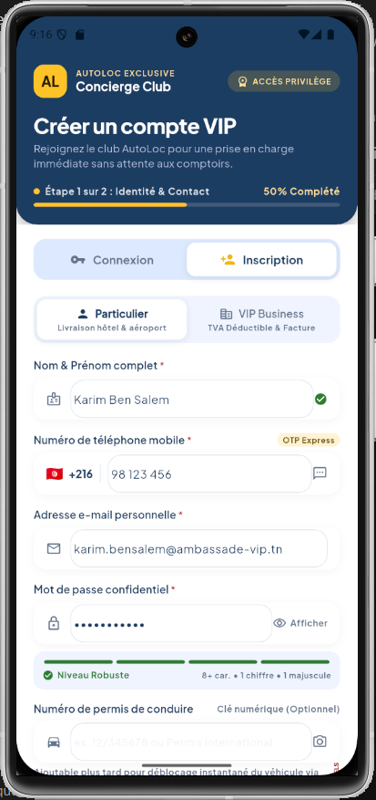
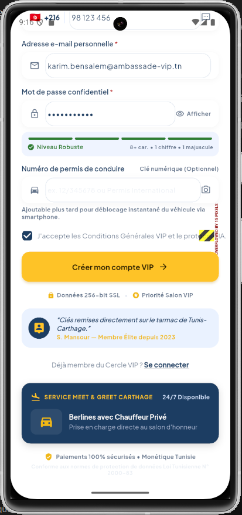
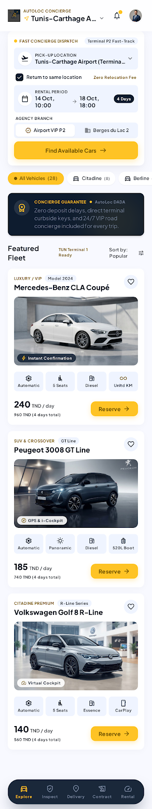
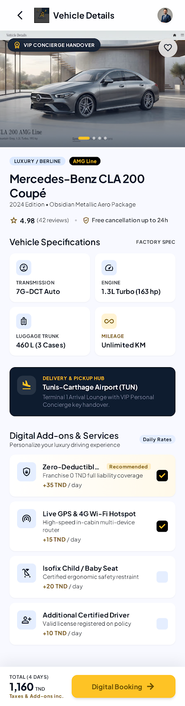
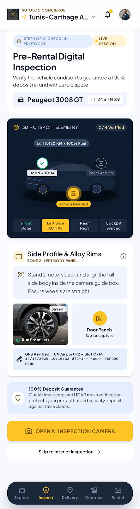
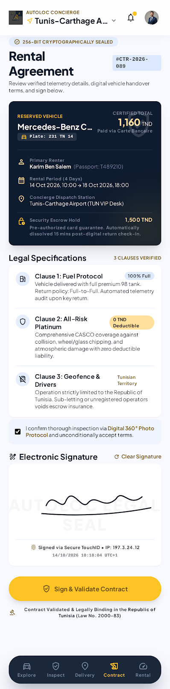
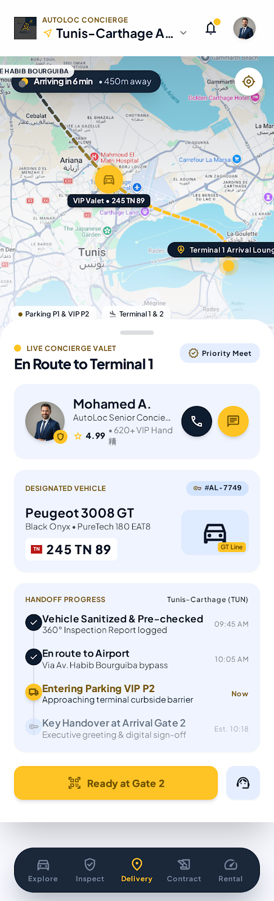
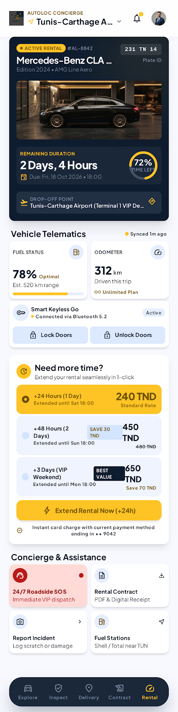

# 🚗 AutoLoc — Executive Concierge Mobility (Tunisie) 🇹🇳 ✨

<p align="center">
  
  <br />
  <strong>La Première Solution Mobile de Conciergerie Automobile Privée & Location de Prestige en Tunisie</strong>
  <br />
  <em>Salon d'Honneur de l'Aéroport International Tunis-Carthage (TUN) • Enfidha-Hammamet • Berges du Lac 2 • Côtes de Carthage</em>
</p>

<p align="center">
  
  
  
  
  
  
</p>

---

## 📑 Sommaire
1. [🌟 Vision & Objectifs de la Solution](#-1-vision--objectifs-de-la-solution)
2. [💎 Les Avantages Clés pour le Client & l'Agence](#-2-les-avantages-clés-pour-le-client--lagence)
3. [📱 Galerie Visuelle & Fonctionnalités Complètes (Avec Captures)](#-3-galerie-visuelle--fonctionnalités-complètes)
   - [A. Connexion & Inscription VIP Sur-Mesure](#a-connexion--inscription-vip-sur-mesure)
   - [B. Découverte de la Flotte & Conciergerie Express](#b-découverte-de-la-flotte--conciergerie-express)
   - [C. Fiche Véhicule & Add-ons Exclusifs](#c-fiche-véhicule--add-ons-exclusifs)
   - [D. Inspection Numérique 360° sans Litige](#d-inspection-numérique-360-sans-litige)
   - [E. Contrat Numérique & Signature Électronique](#e-contrat-numérique--signature-électronique)
   - [F. Suivi Concierge Tarmac en Temps Réel](#f-suivi-concierge-tarmac-en-temps-réel)
   - [G. Pilotage de la Location Active & Extension 1-Clic](#g-pilotage-de-la-location-active--extension-1-clic)
4. [🏛️ Architecture Logicielle & Choix Technologiques](#-4-architecture-logicielle--choix-technologiques)
5. [🚀 Guide de Lancement & Commandes Utiles](#-5-guide-de-lancement--commandes-utiles)

---

## 🌟 1. Vision & Objectifs de la Solution

En Tunisie, la location de voitures traditionnelle souffre de points de friction majeurs :
* **Files d'attente interminables** aux comptoirs des aéroports après un vol long-courrier.
* **Paperasse manuscrite lente et archaïque**, source d'erreurs et de retards.
* **Manque de transparence tarifaire** (cautions bloquées excessives, litiges sur l'état des lieux au retour).
* **Absence de services de mobilité de luxe dédiés** aux délégations diplomatiques, chefs d'entreprises et personnalités VIP.

### 🎯 Les Objectifs d'AutoLoc :
1. **Digitaliser 100 % du parcours client** : De la réservation jusqu'à la restitution du véhicule, sans aucun formulaire papier.
2. **Garantir un accueil Tarmac / Salon VIP** : Remise directe des clés sur le tarmac de Tunis-Carthage ou au Salon d'Honneur (Terminal 1 / Terminal VIP P2).
3. **Assurer une transparence financière totale en Dinars Tunisiens (TND)** : Aucun frais caché, politique "Garantie AutoLoc DADA" avec zéro frais de restitution.
4. **Respecter scrupuleusement la réglementation tunisienne** :
   * Protection stricte des données personnelles selon la **Loi INPDP N° 2004-63**.
   * Intégration de la passerelle de paiement **ClicToPay** certifiée par le **GIE Monétique Tunisie**.
   * Gestion avancée de la **TVA déductible** et du **Matricule Fiscal (MF)** pour les comptes entreprises.

---

## 💎 2. Les Avantages Clés pour le Client & l'Agence

| Pour le Client VIP / Voyageur d'Affaires | Pour l'Agence & l'Opérateur de Conciergerie |
| :--- | :--- |
| ⏱️ **Gain de temps record** : Réception du véhicule en moins de 3 minutes à la sortie de l'avion. | 📈 **Optimisation opérationnelle** : Moins de personnel monopolisé aux comptoirs physiques. |
| 🛡️ **Zéro stress de caution** : Conditions de garantie claires et pré-validées. | 🔒 **Sécurisation des paiements** : ClicToPay & Monétique Tunisie avec protocoles 3D-Secure. |
| 🚘 **Flotte d'exception garantie** : Modèle exact réservé garanti (pas de déclassement de catégorie). | 📸 **Preuve irréfutable de l'état du véhicule** : Photos horodatées et géolocalisées réduisant les litiges à 0%. |
| 📱 **Déblocage numérique sans contact** : Clé numérique sur smartphone optionnelle. | ⚖️ **Validité légale immédiate** : Contrats certifiés horodatés archivés numériquement. |
| 🛎️ **Conciergerie 24/7 incluse** : Chauffeur privé, assistance bilingue, accès salons d'aéroports. | 🔄 **Revenus récurrents maximisés** : Extension de location en 1 clic directement dans l'application. |

---

## 📱 3. Galerie Visuelle & Fonctionnalités Complètes

### A. Connexion & Inscription VIP Sur-Mesure
Un accueil visuel haut de gamme en **Midnight Navy** et **Or Moutarde**. L'utilisateur choisit entre compte **Particulier** et **VIP Business** avec contrôle de robustesse du mot de passe en temps réel et sélection de la langue (**Français, Anglais, Arabe**).

<p align="center">
  
  &nbsp;&nbsp;&nbsp;&nbsp;
  
</p>

* **Bascule instantanée** : Connexion simplifiée (e-mail, mot de passe avec affichage sécurisé, Face ID / Tarmac Pass).
* **Compte Entreprise** : Champ dédié au Matricule Fiscal tunisien pour facturation avec TVA déductible.
* **Sécurité renforcée** : Jauge de complexité mot de passe (8+ car., chiffre, majuscule) et stockage token chiffré AES-256.

---

### B. Découverte de la Flotte & Conciergerie Express
L'écran d'exploration rassemble la recherche de conciergerie à l'Aéroport Tunis-Carthage (Terminal 1 & Terminal P2) et le catalogue de berlines de prestige.

<p align="center">
  
</p>

* **Filtres dynamiques par catégorie** : Tous les véhicules, Citadines premium, Berlines d'affaires, SUV & 4x4, Luxury / VIP.
* **Fiches techniques précises** : Transmission automatique, nombre de places, motorisation (Diesel, Essence, Hybride), caractéristiques exclusives (KM illimité, Apple CarPlay, toit panoramique).
* **Tarification claire** : Prix par jour en TND et montant total de la période de location sélectionnée.
* **Barre de navigation flottante VIP** : 5 raccourcis arrondis (Explorer, Inspecter, Livraison, Contrat, Location).

---

### C. Fiche Véhicule & Add-ons Exclusifs
Présentation détaillée du modèle sélectionné avec options de conciergerie à la carte.

<p align="center">
  
</p>

* **Galerie photo studio** : Vues extérieure 3/4, habitacle cuir et finitions de luxe.
* **Add-ons VIP disponibles** :
  * 🤵 Chauffeur privé bilingue (Français / Anglais / Arabe).
  * 💺 Siège enfant premium ISOFIX.
  * 📶 Boîtier Wi-Fi 4G/5G haute vitesse illimité.
  * ✈️ Pass accès Salon d'Honneur VIP Tunis-Carthage.

---

### D. Inspection Numérique 360° sans Litige
Un état des lieux numérique guidé, transparent et infalsifiable avant la prise du véhicule et lors de la restitution.

<p align="center">
  
</p>

* **Guide photo interactif** : Capture des 4 angles de carrosserie, du niveau de carburant et du compteur kilométrique.
* **Horodatage & Géolocalisation** : Chaque photo est certifiée par empreinte temporelle et GPS.
* **Zéro litige** : Comparaison automatique entre l'état de départ et l'état de retour.

---

### E. Contrat Numérique & Signature Électronique
Génération instantanée du contrat de location officiel en français et arabe conforme à la législation tunisienne.

<p align="center">
  
</p>

* **Signature tactile sur écran** : Signature biométrique fluide et réactive.
* **Conformité juridique** : Clauses contractuelles claires, conformité INPDP Loi 2004-63.
* **Génération PDF instantanée** : Envoyée automatiquement par e-mail et accessible hors-ligne dans l'application.

---

### F. Suivi Concierge Tarmac en Temps Réel
Permet au voyageur de suivre l'approche de son chauffeur ou de sa voiture dès l'atterrissage à Tunis-Carthage.

<p align="center">
  
</p>

* **Carte radar en direct** : Visualisation GPS du concierge en approche du terminal.
* **Carte chauffeur dédiée** : Photo, nom du concierge, plaque d'immatriculation tunisienne (ex: 234 TUN 5678).
* **Communication 1-Clic** : Appel direct sécurisé ou échange via WhatsApp Business Concierge.

---

### G. Pilotage de la Location Active & Extension 1-Clic
L'espace de bord durant la période de location pour prolonger son séjour ou gérer son véhicule sans se déplacer.

<p align="center">
  
</p>

* **Tableau de bord connecté** : Heure exacte de restitution, niveau de carburant restant, kilomètres parcourus.
* **Prolongation instantanée** : Ajout de 24h, 48h ou plus en 1 clic avec recalcul immédiat du tarif.
* **Bouton d'assistance VIP 24/7** : Déclenchement rapide de dépannage ou changement de véhicule.

---

## 🏛️ 4. Architecture Logicielle & Choix Technologiques

### A. Clean Architecture Strict
Le projet isole parfaitement la logique métier des détails d'infrastructure :
* **`domain/`** : Entités métier (`UserEntity`, `VehicleEntity`) et interfaces de référentiels (`AuthRepository`, `VehicleRepository`). Totalement découplé de Flutter et de toute dépendance tierce.
* **`data/`** : Modèles sérialisables (`VehicleModel`) et implémentations locales / API (`MockVehicleRepository`).
* **`presentation/`** : Couche d'affichage réactive avec séparation totale UI / Logique.

### B. 100 % StatelessWidget & Cubit (Freezed)
* Aucun `StatefulWidget` ni `setState()` local.
* États prédictibles, immuables et testables générés avec `freezed`.
* L'UI écoute l'état via `BlocBuilder` et dispatch des actions claires (`loadVehicles()`, `selectCategory()`).

### C. Single Responsibility Principle (SRP)
* Chaque widget vit dans son propre fichier (< 100 à 150 lignes).
* Découpage en sous-dossiers thématiques (`headers/`, `forms/`, `cards/`, `filters/`, `navigation/`).
* Centralisation des exports dans des fichiers barils `widgets.dart`.

### D. Conception Responsive & Zéro Overflow
* Calibré sur base **390 x 844 px** via `flutter_screenutil`.
* Tous les textes imbriqués dans des lignes horizontales sont enveloppés dans des `Flexible(fit: FlexFit.loose)` avec `TextOverflow.ellipsis` pour éliminer tout risque d'overflow sur tous les formats d'écrans Android et iOS.

---

## 🚀 5. Guide de Lancement & Commandes Utiles

### Prérequis
* **Flutter** : version 3.29.0 ou ultérieure
* **Dart** : version 3.9.0 ou ultérieure
* **Android Studio / Xcode** avec émulateur ou smartphone connecté

### Démarrage Rapide
```bash
# 1. Cloner le projet
git clone https://github.com/hammamisahar123/AutoLoc_mobile.git
cd AutoLoc_mobile

# 2. Installer les packages
flutter pub get

# 3. Générer le code immuable Freezed
dart run build_runner build --delete-conflicting-outputs

# 4. Lancer l'analyse de qualité (0 avertissement garanti)
flutter analyze

# 5. Exécuter les tests unitaires et widgets
flutter test

# 6. Démarrer l'application sur émulateur ou mobile
flutter run
```

---

<p align="center">
  <strong>AutoLoc — L'Excellence de la Mobilité de Prestige en Tunisie</strong> 🇹🇳<br />
  <em>Conçu et développé avec rigueur professionnelle, passion et respect des plus hauts standards d'ingénierie logicielle.</em>
</p>
